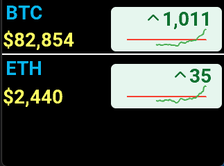

# Crypto View

This is an application running on Vobot mini dock that shows current crypto price and history provided by Kraken API.

A list of all tradable pairs can be retrieved from Kraken using the API https://api.kraken.com/0/public/AssetPairs.

For example, Bitcoin/USD is XXBTZUSD and Ethereum/USD is ETCUSD.

Price difference and history are calculated from the opening price provided from Kraken Ticker Information API.

